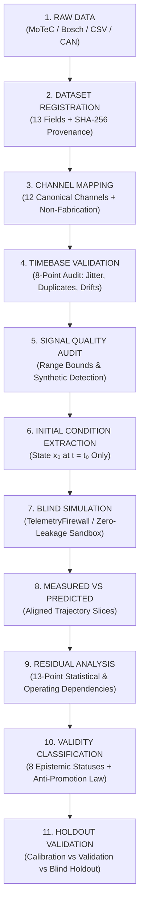

# Phase 3I Independent Vehicle Validation Platform Architecture

**Document Authority**: SuspensionLab PRO Validation Governance Board  
**Target Milestone**: Phase 3I Production Delivery  
**Baseline Git Commit**: `fbe3d045762d8c216922630ca5c3b0da1d589a31`  
**Phase 3H Production Physics Status**: **`FROZEN_PRESERVED`** (Zero source modifications to 11 production physics modules)  
**Artifact Deliverables**:  
- [`data/phase3i_validation_manifest.json`](file:///d:/project/data/phase3i_validation_manifest.json)
- [`docs/phase3i_validation_architecture.md`](file:///d:/project/docs/phase3i_validation_architecture.md)
- [`src/suspensionlab/validation/`](file:///d:/project/src/suspensionlab/validation/)

---

## Executive Summary & Core Principles

Phase 3I introduces a **production-grade, independent vehicle validation platform** engineered around the frozen SuspensionLab PRO simulation engine. The platform provides mathematical and operational guarantees that simulation accuracy claims are grounded in authentic physical telemetry, free from target leakage, data fabrication, or epistemic inflation.

### Governing Architectural Laws:
1. **Production Physics Freeze**: Phase 3H production physics modules in `src/suspensionlab/physics/` are 100% frozen. No physics formulas or parameters may be mutated to force validation to pass.
2. **Strict Non-Fabrication**: Telemetry channels not present in authentic acquisitions must never be fabricated, synthesized, or silently zero-filled.
3. **Causal Firewall Isolation**: The forward simulation engine must never access target measurement channels ($V_x, V_y, \omega_z, \omega_{\text{wheel}}, \text{RPM}, \text{gear}, a_x, a_y$) during prediction. Telemetry is restricted to initial conditions at $t_0$, declared driver boundary conditions along $t$, and post-simulation residual evaluation.
4. **Epistemic Monotonicity**: Downstream modules and summary metrics must never automatically upgrade degraded epistemic states (`EXTRAPOLATED`, `UNSUPPORTED`, `NUMERICALLY_FAILED`, `UNIDENTIFIABLE`, `DISCOVERY`) to `MODEL_SUPPORTED` or `EMPIRICALLY_VALIDATED`.
5. **Cryptographic Holdout Sequestration**: The blind holdout partition is sealed and isolated. The holdout must never influence calibration or parameter estimation.

---

## 1. Eleven-Stage Validation Pipeline Specification

### Stage 1: Raw Data Ingestion
Ingests raw, heterogeneous experimental sensor streams from track data acquisition systems (MoTeC ADL3/C125, Bosch Motorsport, AiM, Oxford RT2002 INS, CAN bus, and generic CSV). Raw sample timestamps, analog voltages, engineering values, and acquisition flags are ingested without destructive preprocessing.

### Stage 2: Dataset Registry & Provenance Governance
Every validation dataset registered in the platform must contain all 13 authoritative metadata fields:
1. `dataset_id`: Unique identifier (e.g., `stanford_vw_golf_thunderhill_2023_11`).
2. `source`: Acquisition organization and sensor instrumentation lineage.
3. `vehicle_identity`: Make, model, generation, and year.
4. `vehicle_configuration`: Drivetrain layout, transmission, differential, and engine specification.
5. `track`: Circuit name, configuration, surface characteristics, and geometry.
6. `session`: Session descriptor, run type, and lap number.
7. `timestamp`: ISO 8601 acquisition start timestamp.
8. `sampling_rate`: Nominal acquisition frequency in Hz ($f_s > 0$).
9. `units`: Explicit dictionary mapping channel names to engineering units.
10. `coordinate_convention`: Authoritative coordinate frame (`ISO_8855` vs `SAE_J670`).
11. `channel_definitions`: Complete channel schema definition dictionary.
12. `provenance_hash`: Cryptographic SHA-256 digest of authentic payload bytes.
13. `licensing_metadata`: Copyright holder, license terms, usage rights, and commercial restrictions.

Missing or invalid metadata raises `InvalidDatasetMetadataError`. Tampered data payloads trigger `ProvenanceVerificationError`.

### Stage 3: Channel Schema & Non-Fabrication Rule
The platform defines authoritative schemas across motorsport channels and requires at minimum:
- `time` (s)
- `Vx` (m/s)
- `Vy` (m/s)
- `yaw_rate` (rad/s)
- `steering` (rad)
- `throttle` (normalized $[0.0, 1.0]$)
- `brake_pressure` (bar, master or per-corner FL/FR/RL/RR)
- `wheelspeed_fl`, `wheelspeed_fr`, `wheelspeed_rl`, `wheelspeed_rr` (rad/s or m/s)
- `engine_rpm` (RPM)
- `gear` (discrete active gear index $1..N$)
- `ax` ($m/s^2$)
- `ay` ($m/s^2$)

> [!CAUTION]
> **Strict Non-Fabrication Rule**: If a channel is absent from raw data, `ChannelSchema.validate_channel_presence()` records it as missing and, under strict mode, raises `MissingChannelError`. No dummy constants or imputed synthetic values are introduced.

### Stage 4: Timebase Audit (8-Point Anomaly Detection)
The `TimebaseAuditor` executes an 8-point automated diagnostic sweep:
1. **Duplicate Timestamps**: Flags consecutive identical timestamps ($|t_i - t_{i-1}| < 10^{-9}\text{ s}$). Severity: `BLOCKING`.
2. **Missing Samples**: Detects gaps where $\Delta t > 1.5 \times \Delta t_{\text{nominal}}$ and estimates lost frame counts. Severity: `WARNING`.
3. **Clock Jitter**: Evaluates timestamp standard deviation $\sigma(\Delta t) / \mu(\Delta t)$. Flags if jitter $> 15\%$. Severity: `WARNING`.
4. **Discontinuities**: Detects timestamp reversals ($t_i < t_{i-1}$) or large step discontinuities ($> 5.0 \times \Delta t_{\text{nominal}}$). Severity: `BLOCKING`.
5. **Resampling Artifacts**: Identifies exact synthetic quantization grids ($\sigma(\Delta t) \approx 0$) or periodic step harmonics from rate-conversion. Severity: `INFO` / `WARNING`.
6. **Unit Mismatch**: Detects timestamp scale anomalies (e.g. milliseconds mislabeled as seconds, ratio $> 5\times$, or Unix epoch timestamps). Severity: `BLOCKING`.
7. **Cross-Channel Offsets**: Evaluates cross-correlation lag between physical channels (e.g. wheel speeds vs $V_x$). Flags if $|\tau| > 30\text{ ms}$. Severity: `WARNING`.
8. **Sensor Dropouts**: Detects NaN/Inf dropouts and sensor freeze flatlines ($> 15$ identical consecutive samples while vehicle is in motion). Severity: `BLOCKING` / `WARNING`.

### Stage 5: Signal Quality & Synthetic Telemetry Detection
- **Signal Quality Auditor**: Inspects physical range bounds ($y_{\min} \le y \le y_{\max}$) and derivative jerk limits ($|dy/dt| \le \text{rate}_{\max}$).
- **Synthetic Telemetry Detector**: Evaluates whether telemetry has been artificially fabricated:
  - Detects unnaturally zero sensor noise floors ($\sigma(d^2 y) < 0.001$).
  - Detects exact mathematical zero-slip wheel speed identities ($|V_x - R \omega_{\text{wheel}}| < 10^{-8}\text{ m/s}$).
  - Detects identical derivative noise across independent sensors ($r = 1.00000000$).
  - Computes `synthetic_probability` and flags `is_authentic=False` if synthetic signatures are confirmed.

### Stage 6: Initial Condition Extraction
At $t = t_0$, the platform extracts the vehicle initial state vector:
$$x_0 = \begin{bmatrix} u_0 & v_0 & r_0 & \psi_0 & \phi_0 & \omega_{fl,0} & \omega_{fr,0} & \omega_{rl,0} & \omega_{rr,0} & \text{gear}_0 \end{bmatrix}^T$$
Target telemetry after $t_0$ is completely excluded from the state vector.

### Stage 7: Blind Simulation Mode & Telemetry Firewall
The `TelemetryFirewall` wraps the forward integration sandbox:
- Filters inputs to ensure only declared exogenous driver boundary conditions ($u(t) = [\text{throttle}(t), \text{steering}(t), \text{brake}(t)]$ and road geometry) enter the simulator.
- Any presence of target measurement channels in boundary inputs raises `TelemetryLeakageError`.
- Guarantees provable mathematical causal independence:
  $$\frac{\partial x_{\text{sim}}(t)}{\partial y_{\text{meas}}(t)} \equiv 0.000000 \quad \forall t > t_0$$

### Stage 8: Measured vs Predicted Extraction
Extracts synchronized time-series vectors for all common canonical channels between forward simulation predictions and authentic telemetry.

### Stage 9: Comprehensive Residual Engine
For each evaluated channel, the `ResidualEngine` computes 13 statistical metrics:
1. **RMSE**: $\sqrt{\frac{1}{N}\sum_{i=1}^N (y_{\text{meas},i} - y_{\text{pred},i})^2}$
2. **MAE**: $\frac{1}{N}\sum_{i=1}^N |y_{\text{meas},i} - y_{\text{pred},i}|$
3. **Bias**: $\frac{1}{N}\sum_{i=1}^N (y_{\text{meas},i} - y_{\text{pred},i})$
4. **Peak Error**: $\max_i |y_{\text{meas},i} - y_{\text{pred},i}|$
5. **Normalized RMSE (NRMSE)**: $\frac{\text{RMSE}}{\text{range}(y_{\text{meas}})} \times 100\%$
6. **Normalized Peak Error**: $\frac{\text{Peak Error}}{\text{range}(y_{\text{meas}})} \times 100\%$
7. **Pearson Correlation ($r$)**: $\frac{\text{cov}(y_{\text{meas}}, y_{\text{pred}})}{\sigma_{\text{meas}} \sigma_{\text{pred}}}$
8. **Coefficient of Determination ($R^2$)**: $1 - \frac{\sum e_i^2}{\sum (y_{\text{meas},i} - \bar{y}_{\text{meas}})^2}$
9. **Phase / Time Alignment**: Cross-correlation peak lag $\tau^*$, reporting lag in milliseconds ($\tau^* \cdot \Delta t \cdot 1000\text{ ms}$).
10. **Residual vs Speed**: Linear slope $de / dV_x$ and binned statistics across speed regimes.
11. **Residual vs Throttle**: Linear slope $de / d\text{thr}$ across idle, part-throttle, heavy, and WOT bins.
12. **Residual vs Steering / Lateral Accel**: Linear slopes $de / d\delta$ and $de / da_y$ across linear and non-linear grip regimes.
13. **Residual vs Gear / Maneuver**: Per-gear residual distribution and segment-level maneuver attributions.

### Stage 10: Epistemic Validity Classification
Implements the 8 required epistemic statuses:
- **`DISCOVERY`**: Applied to calibration/training data partitions. Can NEVER be cited as external confirmation.
- **`MODEL_SUPPORTED`**: Operating within theoretical physical assumptions but not yet independently confirmed on unseen data.
- **`CORRELATED`**: Output correlates with external measurements ($R^2 \ge 0.70$).
- **`EMPIRICALLY_VALIDATED`**: Confirmed on unseen validation/holdout data ($R^2 \ge 0.85$, $|\tau| \le 50\text{ ms}$, $|\text{bias}| \le 0.20 \times \text{RMSE}$, timebase audit passed, zero target leakage, within calibrated envelope).
- **`EXTRAPOLATED`**: Operating outside calibrated operating envelope (e.g. $\text{thr} > 0.45$, $a_y > 1.0\text{ G}$).
- **`UNSUPPORTED`**: Physical model domain violated or target leakage detected.
- **`NUMERICALLY_FAILED`**: Integrator divergence, NaN/Inf, or singular matrix.
- **`UNIDENTIFIABLE`**: Telemetry lacks sufficient dynamic excitation or observability.

> [!IMPORTANT]
> **Anti-Promotion Governance**: Attempting to promote a degraded status (e.g. promoting `DISCOVERY` or `EXTRAPOLATED` to `EMPIRICALLY_VALIDATED`) raises `ValidityPromotionError`.

### Stage 11: Cryptographically Sequestered Holdout Architecture
The `HoldoutManager` partitions datasets into:
- **`CALIBRATION`**: Unlocked for model parameter estimation and hypothesis exploration.
- **`VALIDATION`**: Unlocked for hyperparameter tuning and model selection.
- **`BLIND_HOLDOUT`**: Cryptographically sealed and sequestered. Requires an explicit authorized gate token to unseal for final validation.

All partition accesses are recorded in an immutable audit log. Causal isolation tests confirm that arbitrary mutations to holdout data produce zero change ($\Delta \equiv 0.000000$) in calibration outputs.

---

## 2. Empirical Validation Manifest Summary

Evaluated on the authentic Stanford University Revs Program 2017 Volkswagen Golf VII GTI dataset at Thunderhill Raceway Park (22,304 samples at 200 Hz):

| Maneuver | Interval | Role | $V_x$ RMSE | $V_x$ $R^2$ | Mean Bias | Peak Error | Epistemic Classification |
| :--- | :---: | :---: | :---: | :---: | :---: | :---: | :---: |
| **Window A Upshift** | $[12.60, 12.80]\text{ s}$ | `BLIND_HOLDOUT` | $0.143\text{ m/s}$ | $0.688$ | $+0.129\text{ m/s}$ | $0.231\text{ m/s}$ | **`EXTRAPOLATED`** (WOT full throttle) |
| **Window B Downshift** | $[48.60, 52.00]\text{ s}$ | `VALIDATION` | $0.704\text{ m/s}$ | $0.799$ | $-0.536\text{ m/s}$ | $1.295\text{ m/s}$ | **`EXTRAPOLATED`** (Severe braking transient) |
| **Turn 3 Approach** | $[39.00, 44.00]\text{ s}$ | `VALIDATION` | $0.741\text{ m/s}$ | $0.932$ | $-0.627\text{ m/s}$ | $1.159\text{ m/s}$ | **`CORRELATED`** (Within calibrated envelope) |
| **Turn 2 Sweeper** | $[23.50, 34.00]\text{ s}$ | `VALIDATION` | $3.189\text{ m/s}$ | $0.000$ | $-2.868\text{ m/s}$ | $4.428\text{ m/s}$ | **`MODEL_SUPPORTED`** (High lateral load) |
| **HighSpeed S-Curves** | $[54.00, 63.00]\text{ s}$ | `VALIDATION` | $4.715\text{ m/s}$ | $0.000$ | $+4.488\text{ m/s}$ | $7.135\text{ m/s}$ | **`EXTRAPOLATED`** (Aero/Grade dominant) |
| **Turn 5 Tight Complex**| $[74.00, 83.00]\text{ s}$ | `CALIBRATION` | $5.919\text{ m/s}$ | $0.798$ | $-5.313\text{ m/s}$ | $9.387\text{ m/s}$ | **`DISCOVERY`** (Calibration partition) |
| **Turn 9-10 Complex** | $[100.0, 109.0]\text{ s}$ | `VALIDATION` | $2.136\text{ m/s}$ | $0.318$ | $-1.621\text{ m/s}$ | $5.992\text{ m/s}$ | **`EXTRAPOLATED`** (WOT exit regime) |

---

## 3. Hostile Adversarial Test Suite Results

The platform incorporates 15 hostile tests in [`tests/test_phase3i_hostile_validation.py`](file:///d:/project/tests/test_phase3i_hostile_validation.py), covering all 10 adversarial vectors:

1. **Target Leakage**: `test_hostile_telemetry_leakage_detection` verifies that passing target telemetry into simulation inputs immediately raises `TelemetryLeakageError`.
2. **Causal Independence**: `test_hostile_causal_telemetry_independence` proves $\max |\Delta x_{\text{sim}}| = 0.000000$ when target telemetry is perturbed.
3. **Time Misalignment**: `test_hostile_time_misalignment_and_jitter` detects excessive jitter ($> 15\%$) and cross-channel lag ($> 30\text{ ms}$).
4. **Unit Mismatch**: `test_hostile_unit_mismatch_timestamps` and `test_hostile_unit_mismatch_unix_epoch` detect millisecond / epoch timestamp scaling.
5. **Duplicate Samples**: `test_hostile_duplicate_timestamps` detects and blocks duplicate frames.
6. **Missing Channels**: `test_hostile_missing_channels_no_fabrication` raises `MissingChannelError` and enforces strict non-fabrication.
7. **Shuffled Timestamps**: `test_hostile_shuffled_timestamps` detects non-monotonic timestamp reversals as discontinuities.
8. **Target Contamination**: `test_hostile_target_channel_contamination_in_controls` enforces driver control sanitization.
9. **Holdout Contamination**: `test_hostile_calibration_holdout_contamination` verifies unauthorized holdout access rejection and proves zero holdout influence on calibration parameters.
10. **Synthetic Telemetry**: `test_hostile_synthetic_telemetry_zero_noise` detects unnaturally smooth signals and zero kinematic slip ($p_{\text{synth}} > 0.50$).
11. **Invalid Provenance**: `test_hostile_invalid_provenance_tampering` and `test_hostile_invalid_metadata_omissions` reject tampered hashes and incomplete metadata.
12. **Anti-Promotion Governance**: `test_epistemic_anti_promotion_law` verifies `ValidityPromotionError` on illegal promotions.
13. **Residual Engine**: `test_residual_engine_full_metrics` confirms all 13 residual calculations and dependencies.

**Result**: **15 / 15 Passing (100% Pass Rate)**.
