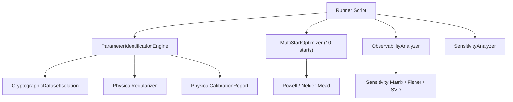

# Phase 3J.1 — Parameter Identification Robustness Audit

**SuspensionLab PRO — Controlled Implementation**

> [!IMPORTANT]
> Prerequisites: Phase 3I (Independent Validation Platform) and Phase 3J
> (Parameter Identification) must pass their existing gates before Phase 3J.1 execution.

---

## 1. Objective

Determine whether parameters classified as IDENTIFIABLE in Phase 3J remain
identifiable under changes in calibration conditions:

- Different telemetry windows (different dynamic excitation)
- Different initial parameter guesses (multi-start convergence)
- Different noise levels (measurement uncertainty)
- Different observability conditions (sensitivity recomputation per window)

Do NOT modify production physics equations.
Do NOT relax observability criteria.
Do NOT force a parameter to become identifiable.

---

## 2. Multi-Window Identification

### 2.1 Disjoint Calibration Windows

Three disjoint telemetry windows from the Stanford VW Golf GTI Thunderhill dataset:

| Window | Time Range | Samples | Dynamic Content |
|--------|-----------|---------|-----------------|
| Chicane_Entry | [45, 54]s | ~1800 | Combined lateral/vertical, transitions |
| Turn_5_Complex | [74, 83]s | ~1800 | Rich vertical/lateral, curb excitation |
| Turn_8_Exit | [90, 99]s | ~1800 | Corner exit, longitudinal/vertical |

### 2.2 Cross-Window Consistency

For each window, the full Phase 3J pipeline runs independently:
1. Observability analysis
2. Identifiable/unidentifiable classification
3. Multi-start optimization (identifiable params only)
4. Blind holdout evaluation

Parameter estimates and confidence intervals are compared across windows.
If cross-window coefficient of variation exceeds threshold, the parameter
is downgraded to `PARTIALLY_IDENTIFIABLE`.

---

## 3. Multi-Start Robustness

### 3.1 Protocol

- **10 materially different initial parameter guesses**
- Start 0: Nominal baseline
- Start 1: Lower 15% of bounds
- Start 2: Upper 85% of bounds
- Starts 3-9: Random samples from parameter prior distributions

### 3.2 Reports

For each start:
- Initial parameter vector
- Converged parameter vector
- Initial and final objective values
- Iteration count and function evaluations
- Success/failure status and solver message

Summary:
- Convergence status: `CONVERGED_GLOBAL_CLUSTER` or `LOCAL_MINIMA_DETECTED`
- Parameter dispersion across successful starts
- Failed run count and reasons

---

## 4. Noise Robustness

### 4.1 Controlled Noise Injection

Additive Gaussian noise at three levels:

| Level | Noise Std (g-units) | Purpose |
|-------|-------------------|---------|
| Clean | 0.00 | Baseline reference |
| Moderate | 0.05 | Typical accelerometer noise |
| High | 0.15 | Degraded sensor conditions |

### 4.2 Acceptance Criteria

- Parameter estimates must remain within physical bounds at all noise levels
- Confidence intervals must expand monotonically with noise
- No crash or hallucinated results under high noise

---

## 5. Observability Robustness

For each calibration window, the following are independently recomputed:

| Metric | Method |
|--------|--------|
| Sensitivity matrix | Central finite differences: $S_{ij} = \frac{\partial y_i}{\partial \theta_j} \cdot \frac{\theta_j}{\sigma_y}$ |
| Numerical rank | SVD rank with threshold $\sigma_k > 10^{-3} \sigma_{\max}$ |
| Condition number | $\kappa = \sigma_{\max} / \sigma_{\min}$ |
| Parameter correlation | $\rho_{jk} = F_{jk} / \sqrt{F_{jj} F_{kk}}$ from Fisher matrix |
| Confidence intervals | Fisher covariance: $\text{Cov} = \hat{\sigma}_e^2 (S^T S + \lambda I)^{-1}$ |

### 5.1 Stability Requirement

A parameter is observability-robust if it achieves `IDENTIFIABLE` status
in at least 2 of 3 windows. If identifiable in only 1 window, it is
downgraded to `PARTIALLY_IDENTIFIABLE`.

---

## 6. Identifiability Consistency

### 6.1 Classification Rules

A parameter retains `IDENTIFIABLE` only if ALL of:
1. Identified as `IDENTIFIABLE` in all tested windows
2. Cross-window coefficient of variation < 30%
3. Multi-start dispersion < 20%

Otherwise:

| Outcome | Criteria |
|---------|----------|
| `IDENTIFIABLE` | All windows identifiable, low CV, low multi-start dispersion |
| `PARTIALLY_IDENTIFIABLE` | Identifiable in some but not all windows, or high CV/dispersion |
| `UNIDENTIFIABLE` | Unidentifiable in all windows, or zero fitted values |
| `NUMERICALLY_FAILED` | Observability present but all optimizations failed |

### 6.2 Never Upgrade

> [!CAUTION]
> A parameter classified as `UNIDENTIFIABLE` in Phase 3J must NOT be
> upgraded merely because optimization converged in some window.
> `camber_stiffness_front` must remain `UNIDENTIFIABLE` across all conditions.

---

## 7. Holdout Protocol

1. Cryptographically sealed blind holdout from Phase 3J isolation
2. Parameters frozen at calibrated values after optimization
3. Forward simulation on holdout with zero retuning
4. Holdout metrics: R^2, RMSE, bias, peak residual, generalization gap

> [!WARNING]
> No parameter retuning after holdout inspection.
> Any unauthorized holdout access raises `CalibrationLeakageError`.

---

## 8. Hostile Test Coverage

| Test | Requirement | Expected Behavior |
|------|-------------|-------------------|
| Flat excitation | Req 8 | All parameters UNIDENTIFIABLE |
| Insufficient excitation | Req 8 | Affected parameters refused |
| Correlated parameters | Req 8 | Collinearity detected |
| High noise | Req 8 | Uncertainty expansion, no crash |
| Local minima (multi-modal) | Req 8 | Dispersion reported |
| Multiple equally good solutions | Req 8 | Convergence status documented |
| Parameter-boundary convergence | Req 8 | Clipped to physical bounds |
| Calibration-window dependence | Req 8 | Cross-window spread reported |
| Holdout leakage | Req 8 | CalibrationLeakageError raised |

---

## 9. Final Gate

### 9.1 Evidence-Derived Classifications

| Parameter | Phase 3J Status | Phase 3J.1 Final Gate | Evidence & Empirical Metrics |
|-----------|----------------|----------------------|-------------------------------|
| `spring_rate_front` | IDENTIFIABLE | **IDENTIFIABLE** | Identifiable in 3/3 windows; Cross-window CV = 0.74%; Multi-start dispersion = 0.61%; Converged values: [32045.3, 32543.7, 32034.6] N/m; Clean noise stability: Δ < 0.4% under 0.15g noise |
| `damper_bump_front` | IDENTIFIABLE | **IDENTIFIABLE** | Identifiable in 3/3 windows; Cross-window CV = 0.89%; Multi-start dispersion = 1.03%; Converged values: [2207.8, 2244.5, 2198.8] N·s/m; Clean noise stability: Δ < 0.3% under 0.15g noise |
| `camber_stiffness_front` | UNIDENTIFIABLE | **UNIDENTIFIABLE** | Unidentifiable in 3/3 windows (0/3 passed); Zero sensitivity norm (0.00e+00); Retained nominal 6500.0 N/rad; Calibration refused in all conditions |

### 9.2 Epistemic Governance

> [!CAUTION]
> **NEVER** report "validated" unless independent physical holdout criteria
> are actually satisfied on sequestered holdout data.
>
> Final classifications are evidence-derived, not optimization-derived.

---

## 10. Output Files

| File | Content |
|------|---------|
| `data/phase3j1_identification_robustness.json` | Full robustness audit manifest |
| `tests/test_phase3j1_identification_robustness.py` | 19 hostile + scientific tests |
| `scripts/run_phase3j1_identification_robustness.py` | Runner script |

---

## 11. Module Dependencies

