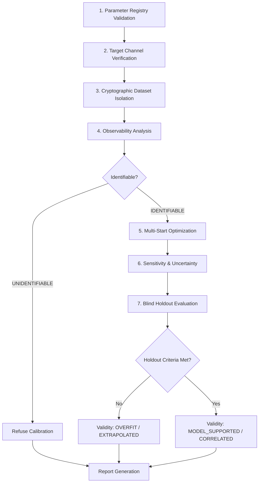

# Phase 3J — Physical Parameter Identification & Observability

**SuspensionLab PRO — Controlled Implementation**

> [!IMPORTANT]
> Phase 3I Independent Validation Platform is a strict prerequisite.
> All Phase 3I tests must pass before Phase 3J pipeline execution.

---

## 1. Architecture Overview

Phase 3J implements a scientifically defensible parameter-identification system that:

1. Registers only parameters from the 11 authorized physical families
2. Determines mathematical identifiability before attempting calibration
3. Refuses impossible calibration with explicit rejection reasons
4. Cryptographically isolates calibration and holdout data
5. Optimizes with robust derivative-free methods (no noisy finite differences)
6. Regularizes against physically meaningless parameter combinations
7. Detects local minima via multi-start convergence analysis
8. Quantifies uncertainty through Fisher Information covariance
9. Evaluates frozen parameters on blind holdout data
10. Never reports "validated" unless independent holdout criteria pass



---

## 2. Parameter Registry

### 2.1 Authorized Parameter Families

Only parameters from these 11 families — already represented in the physics models — are permitted:

| # | Family | Example Parameters | Model Dependencies |
|---|--------|-------------------|-------------------|
| 1 | Tire Stiffness | `k_tire_front`, `k_tire_rear`, `cornering_stiff_front/rear` | QuarterCar, FullCar7DOF, DynamicLapSim |
| 2 | Tire Load Sensitivity | `tire_load_degressivity` | PacejkaMF52, HandlingBicycleModel |
| 3 | Camber Sensitivity | `camber_stiffness_front/rear` | HandlingBicycleModel, KinematicsFacade |
| 4 | Aero Coefficients | `aero_cd`, `aero_cl` | PowertrainLongitudinal, DynamicLapSim |
| 5 | Aero Balance | `aero_front_balance` | FullCar7DOF, HandlingBicycleModel |
| 6 | Drivetrain Efficiency | `drivetrain_efficiency` | PowertrainLongitudinal |
| 7 | Rolling Resistance | `rolling_resistance_coeff` | PowertrainLongitudinal |
| 8 | Suspension Stiffness | `spring_rate_front/rear`, `anti_roll_bar_front/rear` | QuarterCar, FullCar7DOF, HalfCar |
| 9 | Damping | `damper_bump_front/rear`, `damper_rebound_front/rear` | QuarterCar, FullCar7DOF, HalfCar |
| 10 | Mass/Inertia | `sprung_mass`, `unsprung_mass_front/rear`, `yaw_inertia_Izz` | All models |
| 11 | Powertrain | `engine_peak_torque`, `final_drive_ratio`, `shift_duration_s`, `clutch_inertia` | TransmissionSM, PowertrainLongitudinal |

### 2.2 Parameter Definition Schema

Every calibratable parameter defines:

```
name:              Canonical identifier
physical_meaning:  Physical description
units:             SI or standard engineering units
nominal_value:     Reference baseline
bounds:            (lower, upper) hard limits
prior:             GaussianPrior(mu, sigma) or UniformPrior(low, high)
source:            Engineering specification provenance
model_dependency:  Physics models that consume this parameter
validity_domain:   Operating envelope (min/max operational, speed range, etc.)
observable_channels: Telemetry channels providing sensitivity
```

### 2.3 Zero Invented Parameters

> [!CAUTION]
> Do NOT invent parameters simply because they improve optimization.
> Attempting to register an unrecognized parameter raises `KeyError`.

---

## 3. Observability Analysis

### 3.1 Formulation

For each candidate parameter $\theta_j$, the observability analyzer computes:

**Normalized Sensitivity Matrix:**
$$S_{ij} = \frac{\partial y_i}{\partial \theta_j} \cdot \frac{\theta_j^{\text{nom}}}{\sigma_{y_i}}$$

where $y_i$ is the $i$-th observable sample and $\sigma_{y_i}$ is the channel standard deviation.

**Fisher Information Matrix:**
$$F = S^T S$$

**Condition Number:**
$$\kappa(F) = \frac{\sigma_{\max}(S)}{\sigma_{\min}(S)}$$

**Numerical Rank:**
$$\text{rank}(S) = |\{\sigma_k : \sigma_k > \epsilon \cdot \sigma_{\max}\}|$$

**Parameter Correlation:**
$$\rho_{jk} = \frac{F_{jk}}{\sqrt{F_{jj} \cdot F_{kk}}}$$

**Excitation Coverage:**
Fraction of observable channels with standard deviation exceeding a minimum threshold.

### 3.2 Identifiability Classification

| Status | Criteria |
|--------|----------|
| `IDENTIFIABLE` | $\|S_j\| > \epsilon$, excitation coverage $> 0.5$, $\kappa(F) < 10^6$, max correlation $< 0.90$ |
| `PARTIALLY_IDENTIFIABLE` | Some but not all criteria met (e.g., high correlation) |
| `UNIDENTIFIABLE` | Zero sensitivity, zero excitation, rank-deficient Fisher, or $\kappa > 10^8$ |

### 3.3 Refusal Protocol

If a parameter is classified as `UNIDENTIFIABLE`:
- `is_fitted = False`
- `calibrated_value = nominal_value` (retained, not optimized)
- `delta_pct = 0.0`
- `rejection_reason` is populated with specific diagnostic

---

## 4. Cryptographic Dataset Isolation

### 4.1 Partitioning

The telemetry dataset is split into calibration and holdout partitions with:
- **SHA-256 fingerprinting** of each partition for tamper detection
- **Guard band** (default 0.50s) separating partitions to prevent spectral leakage
- **Token-based firewall** controlling holdout access

### 4.2 Leakage Prevention

```
Calibration data    →  Freely accessible during optimization
Holdout data        →  SEALED until explicit token unlock
                       Any unauthorized access raises CalibrationLeakageError
```

> [!WARNING]
> Accessing holdout data without the cryptographic unlock token raises
> `CalibrationLeakageError: CALIBRATION FIREWALL LEAKAGE DETECTED`

---

## 5. Derivative-Free Multi-Start Optimization

### 5.1 Solver Selection

Powell's conjugate-direction method (default) or Nelder-Mead simplex:
- No gradient computation through adaptive ODE solvers
- No noisy finite differences
- Robust to non-smooth objective landscapes

### 5.2 Multi-Start Protocol

Multiple optimization runs from Latin Hypercube-sampled initial conditions:
- `num_starts >= 3` (default)
- Convergence assessed via parameter dispersion across starts
- If dispersion > threshold: `LOCAL_MINIMA_DETECTED`
- If all starts converge to same region: `CONVERGED_GLOBAL_CLUSTER`

### 5.3 Objective Function

$$\mathcal{L}(\theta) = \sum_{c \in \text{channels}} \frac{\text{MSE}(y_c^{\text{meas}}, y_c^{\text{sim}}(\theta))}{\text{Var}(y_c^{\text{meas}})} + \lambda_{\text{reg}} \cdot R(\theta)$$

where $R(\theta)$ is the physical regularization penalty.

---

## 6. Physical Regularization

Prevents physically meaningless parameter combinations:

| Invariant | Constraint |
|-----------|------------|
| Damping ratio | $0.12 \leq \zeta = \frac{c}{2\sqrt{k \cdot m}} \leq 1.5$ |
| Roll balance | Front ARB contribution between 30%–70% of total |
| Mass ratios | $m_u / m_s < 0.10$ per corner |
| Tire degressivity | Must be positive (tire friction decreases with load) |
| Bound enforcement | Barrier penalty for parameters exceeding physical bounds |

---

## 7. Sensitivity & Uncertainty Quantification

For every fitted parameter:

**Local Sensitivity:**
$$\frac{\partial y}{\partial \theta_j} \approx \frac{y(\theta_j + \epsilon) - y(\theta_j)}{\epsilon}$$

**Fisher Covariance:**
$$\text{Cov}(\hat{\theta}) = \hat{\sigma}_e^2 \cdot (S^T S + \lambda I)^{-1}$$

**Standard Error & 95% Confidence Interval:**
$$\text{SE}(\theta_j) = \sqrt{\text{Cov}_{jj}}, \quad \text{CI}_{95} = \hat{\theta}_j \pm 1.96 \cdot \text{SE}(\theta_j)$$

**Channel Elasticities:**
Percentage change in each observable per 1% change in each parameter.

---

## 8. Blind Holdout Validation

### 8.1 Protocol

1. Parameters are **frozen** at their calibrated values
2. Holdout partition is **unlocked** with cryptographic token
3. Forward simulation runs on holdout data with **zero retuning**
4. Holdout metrics (R², RMSE, bias, peak residual) are computed
5. Generalization gap = holdout RMSE − training RMSE

### 8.2 Validity Classification

| Classification | Criteria |
|---------------|----------|
| `MODEL_SUPPORTED` | Holdout R² ≥ 0.70, generalization gap acceptable |
| `CORRELATED` | Holdout R² ∈ [threshold, 0.70), gap acceptable |
| `OVERFIT` | Good training R² but holdout fails (gap too large) |
| `EXTRAPOLATED` | Moderate holdout R² with marginal gap |
| `UNIDENTIFIABLE` | All parameters refused or holdout R² < 0.20 |

> [!CAUTION]
> The word "validated" is NEVER used unless the independent physical holdout
> criteria are actually satisfied on sequestered holdout data.

---

## 9. Hostile Test Coverage

| Test | Requirement | Expected Behavior |
|------|-------------|-------------------|
| Flat signal | Req 3, 11 | All parameters UNIDENTIFIABLE, no fitted values |
| Insufficient excitation | Req 11 | Affected parameters refused |
| Perfectly correlated params | Req 11 | Collinearity detected, PARTIALLY_IDENTIFIABLE |
| Noisy telemetry | Req 8, 11 | Confidence intervals expand proportionally |
| Optimizer failure | Req 11 | Graceful degradation, no crash or hallucination |
| Local minima | Req 7, 11 | Multi-start dispersion flagged |
| Parameter outside bounds | Req 6, 11 | Barrier penalty, physically inadmissible |
| Missing target channel | Req 11 | Strict ValueError rejection |
| Calibration leakage | Req 4, 11 | CalibrationLeakageError raised |
| Overfitting | Req 12 | Refuses "validated" verdict |

---

## 10. Module Architecture

| Module | Responsibility |
|--------|---------------|
| `calibration/registry.py` | 28 parameters across 11 families, priors, validity domains |
| `calibration/isolation.py` | SHA-256 partitioning, guard bands, firewall |
| `calibration/observability.py` | Sensitivity matrix, Fisher rank, excitation, classification |
| `calibration/regularization.py` | Physical invariants, bound barriers |
| `calibration/optimizer.py` | Multi-start Powell/Nelder-Mead, convergence analysis |
| `calibration/sensitivity.py` | Fisher covariance, std errors, CIs, elasticities |
| `calibration/report.py` | ParameterResult, HoldoutPerformanceRecord, JSON export |
| `calibration/engine.py` | 9-step pipeline orchestration |

---

## 11. Required Outputs

### 11.1 Calibration Manifest

`data/phase3j_calibration_manifest.json` contains:

```json
{
  "validity_classification": "MODEL_SUPPORTED | CORRELATED | OVERFIT | UNIDENTIFIABLE",
  "is_validated": "true | false",
  "fitted_parameters": { "..." },
  "unidentifiable_parameters": [ "..." ],
  "refusal_summary": { "..." },
  "observability": { "..." },
  "convergence": { "..." },
  "holdout_performance": { "..." },
  "residual_changes": { "..." },
  "uncertainty": { "..." }
}
```

### 11.2 Test Suites

- `tests/test_phase3j_parameter_identification.py`: 14 hostile + scientific tests
- `tests/test_phase3i_validation_platform.py`: 9 prerequisite tests
- `tests/test_independent_scientific_validation.py`: 13 foundation tests

---

## 12. Epistemic Governance

> [!CAUTION]
> **NEVER** report "validated" unless:
> 1. Independent physical holdout criteria are satisfied on sequestered data
> 2. Generalization gap is within acceptable bounds
> 3. Optimizer converged (not failed)
> 4. At least one parameter is identifiable
>
> Any violation of these conditions forces `is_validated = False`.
