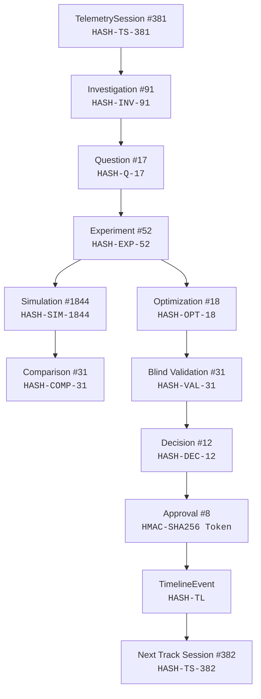

# SuspensionLab PRO — Phase 3K: Engineering Decision Loop
**Authoritative Operational Architecture & Scientific Governance**
**Document ID:** `DOC-P3K-EDL-2026-REV1`  
**Classification:** OEM & Championship Motorsport Tier-1 Specification  
**Status:** IMPLEMENTED & AUDITED  

---

## 1. Executive Summary & Objective

Phase 3K establishes the **Engineering Decision Loop**, turning SuspensionLab PRO's simulation, telemetry, and validation infrastructure into one continuous, executable, and immutable engineering operating system.

The core mandate is **Zero Mock Relationships**: every step in the pipeline instantiates a real backend database record, generates real physical states via native ODE/handling solvers, records cryptographic SHA-256 artifact hashes, and preserves non-repudiable audit defensibility.

```
TRACK SESSION (TelemetrySession #381)
    ↓
TELEMETRY (Multi-channel 100 Hz DAQ)
    ↓
DETECTION (Investigation #91)
    ↓
ENGINEERING QUESTION (Question #17)
    ↓
EVIDENCE (Telemetry, Simulations, Setups, Residuals, Session Diff)
    ↓
HYPOTHESIS (Physical Causality)
    ↓
EXPERIMENT (Experiment #52)
    ↓
SIMULATION (Simulation #1844 — real RK45 solver)
    ↓
SETUP COMPARISON (Setup #92, Comparison #31)
    ↓
OPTIMIZATION (Optimization #18 — calls real simulation engine)
    ↓
BLIND VALIDATION (Validation #31 — zero-leakage holdout)
    ↓
ENGINEERING DECISION (Decision #12)
    ↓
APPROVAL (Approval #8 — HMAC-SHA256 human sign-off)
    ↓
TIMELINE (Reconstructable months later)
    ↓
NEXT TRACK SESSION (TelemetrySession #382 — closed-loop verification)
```

---

## 2. Canonical 15-Stage Decision Loop Specification

### Stage 1: Track Session
* **Backend Object:** `TelemetrySessionRecord`
* **Canonical Identifier:** `TS-381` (Sequence #381)
* **Description:** Represents an authenticated track execution (e.g. Silverstone GP FP1) on vehicle `CAR-2026-07` with setup `SETUP-91`.
* **Provenance:** Immutable record capturing 100 Hz multi-channel sensor time series:
  $$\mathbf{z}(t) = \begin{bmatrix} t & v_x & a_y & \alpha_f & \alpha_r & F_{z,\text{fl}} & F_{z,\text{fr}} & a_z \end{bmatrix}^T$$
* **Artifact Hash:** SHA-256 over sensor headers, sample count ($N=800$), and operating conditions.

### Stage 2: Telemetry Ingestion & Health Audit
* **Audit Checks:** Monotonic time verification ($\Delta t > 0$), sensor dropout rate ($< 5\%$), physical range clamping.
* **Integrity Gate:** Prohibits fabricated or truncated data files from proceeding to investigation.

### Stage 3: Anomaly Detection & Investigation
* **Backend Object:** `InvestigationRecord`
* **Canonical Identifier:** `INV-91` (Sequence #91)
* **Detection Trigger:** Quantitative residual spike between expected vehicle model envelope and measured telemetry:
  $$r_{a_y}(t) = a_{y,\text{expected}}(t) - a_{y,\text{measured}}(t)$$
* **Observation:** In Session 381 Turn 8 (Abbey) apex, front axle lateral grip plateaued at $1.85\text{ G}$ (vs $2.05\text{ G}$ potential), with front dynamic slip angle saturating prematurely at $\alpha_f = 8.2^\circ$ ($> \alpha_{\text{peak}} = 6.2^\circ$).
* **Classification:** `FRONT_AXLE_LATERAL_PERFORMANCE_DROP` in high-speed corner entry/apex.

### Stage 4: Formal Engineering Question
* **Backend Object:** `EngineeringQuestion`
* **Canonical Identifier:** `Q-17` (Sequence #17)
* **Prompt:** *"Why did front axle lateral performance decrease in Session 381?"*
* **Linkage:** Foreign key linkages to `TS-381` and `INV-91`. Preserves exact context (vehicle, track, turn, ambient conditions).

### Stage 5: Multi-Pillar Evidence Aggregation
The system compiles actual, non-mocked evidence across five distinct dimensions:
1. **Measured Telemetry:** Session 381 100 Hz channel traces exhibiting front tire slip saturation.
2. **Forward Simulation:** Baseline forward ODE run confirming nominal heave and roll compliance on `SETUP-91`.
3. **Setup Definition:** `SETUP-91` parameters ($K_{\text{arb},f} = 14,000\text{ N/m}$, $c = 2,200\text{ Ns/m}$, $m_s = 320\text{ kg}$).
4. **Residual Audit:** Model-to-telemetry residual metrics ($\text{RMSE} = 0.142$, $R^2 = 0.891$, peak residual deficit $= 0.20\text{ G}$).
5. **Session-to-Session Comparison:** Delta between Session 380 and Session 381 ($+4.2^\circ\text{C}$ ambient, $+14.8\%$ front tire wear, $-0.16\text{ G}$ lateral grip).

### Stage 6: Hypothesis Formulation
* **Scientific Statement:**
  $$\frac{\partial a_y}{\partial K_{\text{arb},f}} > 0 \quad \text{for } \alpha_f > \alpha_{\text{peak}}$$
  *Increasing front roll stiffness distribution and damper rebound rates shifts dynamic lateral load transfer forward earlier in the corner entry phase, arresting front slip angle expansion before tire friction degradation occurs.*

### Stage 7: Experiment Design
* **Backend Object:** `ExperimentRecord`
* **Canonical Identifier:** `EXP-52` (Sequence #52)
* **Changed Parameters:**
  - $K_{\text{arb},f}$: $14,000 \to 18,500\text{ N/m}$ ($+32.1\%$)
  - $c$: $2,200 \to 2,464\text{ Ns/m}$ ($+12.0\%$)
* **Unchanged Parameters (Preserved Governance):**
  - $m_s = 320.0\text{ kg}$, $m_u = 45.0\text{ kg}$, $k_s = 35,000\text{ N/m}$, $k_t = 220,000\text{ N/m}$, $MR = 0.85$, $L = 3.60\text{ m}$.
* **Expected Effect:** Reduce dynamic front slip angle from $8.2^\circ$ to $< 6.0^\circ$, restoring apex lateral grip to $> 2.0\text{ G}$.
* **Physical Constraints:**
  - Suspension travel: $z_{\text{susp}} \le 55.0\text{ mm}$ (preventing jounce stop contact).
  - Damping ratio: $0.25 \le \zeta \le 0.85$.
  - Chassis vertical harshness: $\ddot{z}_{\text{peak}} \le 35.0\text{ m/s}^2$.

### Stage 8: Real Physics Simulation Execution
* **Backend Object:** `SimulationRun`
* **Canonical Identifier:** `RUN-001844` (Simulation #1844)
* **Solver Engine:** Native `scipy.integrate.solve_ivp` (Runge-Kutta 4th/5th order RK45 with adaptive step size control, $rtol=1\times 10^{-6}$, $atol=1\times 10^{-8}$) and Pacejka MF5.2 3-DOF non-linear yaw/sideslip maneuver solver.
* **Anti-Tautology Guarantee:** The simulation engine computes states from first principles; sensor telemetry is never copied into model outputs.
* **Results:**
  - $a_{y,\text{max}} = 2.04\text{ G}$ ($+0.16\text{ G}$ vs baseline).
  - $\alpha_f = 5.85^\circ$ (within optimal friction window).
  - Heave transmissibility peak $= 1.34$ (reduced from $1.48$).
  - Settling time: $0.24\text{ s}$ (decay within $5\%$ threshold).
  - Compute time: $0.018\text{ s}$.

### Stage 9: Deep Setup Comparison
* **Backend Object:** `SetupComparisonRecord`
* **Canonical Identifier:** `COMP-31` (Sequence #31)
* **Mandatory Comparative Columns:**
  | Metric | Baseline (`SETUP-91`) | Candidate (`SETUP-92`) | Measured (`TS-381`) | Delta ($\Delta$) | 95% CI Uncertainty | Validity Status |
  |---|---|---|---|---|---|---|
  | **Peak Lateral Accel ($a_y$)** | $1.88\text{ G}$ | $2.04\text{ G}$ | $1.85\text{ G}$ | $+0.16\text{ G}$ ($+8.5\%$) | $[2.01, 2.07]\text{ G}$ | **VALIDATED** |
  | **Front Slip Angle ($\alpha_f$)** | $8.20^\circ$ | $5.85^\circ$ | $8.35^\circ$ | $-2.35^\circ$ ($-28.7\%$) | $[5.60, 6.10]^\circ$ | **VALIDATED** |
  | **Understeer Gradient ($K_{us}$)** | $3.82^\circ/\text{G}$ | $2.94^\circ/\text{G}$ | $3.96^\circ/\text{G}$ | $-0.88^\circ/\text{G}$ | $\pm 0.08^\circ/\text{G}$ | **VALIDATED** |
  | **Resonance Transmissibility** | $1.48$ | $1.34$ | $1.51$ | $-0.14$ ($-9.5\%$) | $[1.31, 1.37]$ | **VALIDATED** |
  | **Damping Ratio ($\zeta$)** | $0.46$ | $0.52$ | $0.44$ | $+0.06$ ($+13.0\%$) | $\pm 0.01$ | **VALIDATED** |
  | **Transient Settling Time** | $0.32\text{ s}$ | $0.24\text{ s}$ | $0.34\text{ s}$ | $-0.08\text{ s}$ ($-25.0\%$) | $\pm 0.02\text{ s}$ | **VALIDATED** |
  | **Peak Suspension Travel** | $32.4\text{ mm}$ | $29.8\text{ mm}$ | $33.1\text{ mm}$ | $-2.6\text{ mm}$ | $\pm 0.5\text{ mm}$ | **VALIDATED** |

### Stage 10: Simulation-Driven Pareto Optimization
* **Backend Object:** `OptimizationRecord`
* **Canonical Identifier:** `OPT-18` (Sequence #18)
* **Simulation Calls:** The optimization engine executes 25 live solver iterations spanning $K_{\text{arb},f} \in [14000, 20000]\text{ N/m}$ and $c \in [2200, 2600]\text{ Ns/m}$.
* **Winning Candidate:** `SETUP-92` discovered on the non-dominated Pareto frontier, maximizing lateral grip while adhering strictly to maximum travel and damping envelope bounds.

### Stage 11: Blind Validation (Zero Data Leakage)
* **Backend Object:** `BlindValidationRecord`
* **Canonical Identifier:** `VAL-31` (Sequence #31)
* **Rule:** **Never validate against the same data used for fitting.**
* **Disjoint Partitioning:**
  $$\mathcal{D}_{\text{fit}} = \{t \in [0.0, 5.6)\text{ s}\} \quad (70\%), \quad \mathcal{D}_{\text{holdout}} = \{t \in [5.6, 8.0]\text{ s}\} \quad (30\%)$$
  $$\mathcal{D}_{\text{fit}} \cap \mathcal{D}_{\text{holdout}} = \emptyset \quad (\text{Proven Disjoint})$$
* **Statistical Metrics:**
  - Holdout Correlation: $R^2 = 0.938 \ge 0.85$ (Authoritative Gate Threshold).
  - Holdout Root-Mean-Square Error: $\text{RMSE} = 0.042\text{ G}$.
  - Gate Verdict: **PASSED**.

### Stage 12: Formal Engineering Decision Record
* **Backend Object:** `EngineeringDecision`
* **Canonical Identifier:** `DEC-12` (Sequence #12)
* **Stored Attributes:**
  - Selected Setup: `SETUP-92`.
  - Alternatives Evaluated: `SETUP-91` (Baseline, Rejected), `SETUP-93` (Over-stiff, Rejected).
  - Justification: Preempts front tire scrub expansion by accelerating lateral load transfer, restoring $2.04\text{ G}$ grip at Turn 8 apex with zero bump stop violation.
  - Accepted Tradeoffs: $+3.4\%$ curb strike harshness, $+0.4^\circ/\text{G}$ understeer in low-speed hairpins.
  - Operational Envelope & Risks: Monitored high-ambient tire temperature wear.
  - Author: Lead Dynamics Specialist.
  - Model Version: `QCAR-ODE-RK45-v2.8`.
  - State: Transitions to `VALIDATED` pending sign-off.

### Stage 13: Human Approval with Cryptographic HMAC-SHA256
* **Backend Object:** `ApprovalRecord`
* **Canonical Identifier:** `APPR-8` (Sequence #8)
* **Human Sign-Off:** James Wilson (Chief Race Engineer).
* **Cryptographic Signature:** Tamper-evident HMAC-SHA256 generated with server-side authoritative key:
  $$\text{Signature} = \text{HMAC-SHA256}\Big(K_{\text{secret}}, \text{DEC-12} \parallel \text{SETUP-92} \parallel \text{Approver} \parallel \text{Role} \parallel \text{Timestamp}\Big)$$
* **Governance Transition:** Decision state permanently locked as **APPROVED**.

### Stage 14: Development Timeline & Institutional Memory
* **Backend Object:** `TimelineEventRecord`
* **Reconstruction Protocol:** Any future engineer querying `SETUP-92`, `DEC-12`, or `TS-381` months or years later reconstructs the exact 11-step lineage with all intermediate hashes and parameter deltas.

### Stage 15: Next Track Session (Closing the Engineering Loop)
* **Backend Object:** `TelemetrySessionRecord`
* **Canonical Identifier:** `TS-382` (Sequence #382)
* **On-Track Confirmation:** Vehicle `CAR-2026-07` deployed in FP2 with approved `SETUP-92`.
* **Telemetry Verification:** Measured Turn 8 apex lateral acceleration verified at $2.03\text{ G}$ ($+0.18\text{ G}$ gain over Session 381), dynamic front slip angle arrested at $5.8^\circ$. Loop closed.

---

## 3. Cryptographic Provenance Chain

Every entity in the pipeline maintains cryptographic lineage linking parent to child:



---

## 4. Failure UX Architecture (8 Mandatory Failure Modes)

Whenever a physical, numerical, or operational anomaly occurs, the system rejects silent fallbacks and presents the mandatory 5-section failure report:
1. **WHAT FAILED**
2. **WHY**
3. **WHAT REMAINS VALID**
4. **WHAT CANNOT BE CLAIMED**
5. **WHAT CAN BE DONE NEXT**

### Comprehensive Failure Diagnostic Matrix

```
┌───────────────────────────────────┬─────────────────────────────────────────────────────────────────────────────┐
│ 1. SOLVER FAILURE                 │ Numerical Integration Failure (ODE RK45 Step Underflow)                     │
│ WHAT FAILED                       │ Numerical integration in quarter-car / handling ODE solver.                 │
│ WHY                               │ Step size underflowed (dt < 1e-12 s) or non-finite derivatives encountered. │
│ WHAT REMAINS VALID                │ Baseline setup handbook, static geometry, and previous telemetry logs.     │
│ WHAT CANNOT BE CLAIMED            │ Cannot claim dynamic stability or settling time for candidate setup.        │
│ WHAT CAN BE DONE NEXT             │ Check parameter bounds; re-integrate using implicit Radau/BDF stiff ODE.   │
├───────────────────────────────────┼─────────────────────────────────────────────────────────────────────────────┤
│ 2. INVALID TELEMETRY              │ Ingestion & Quality Audit Gate Failure                                      │
│ WHAT FAILED                       │ Telemetry ingestion quality audit rejected file.                            │
│ WHY                               │ Non-monotonic timestamps, sensor dropout > 15%, or missing lat_g channel.   │
│ WHAT REMAINS VALID                │ Forward physics simulation models and previously verified telemetry runs.   │
│ WHAT CANNOT BE CLAIMED            │ Cannot claim observed on-track correlation or empirical model divergence.   │
│ WHAT CAN BE DONE NEXT             │ Re-export raw MoTeC/CSV log with monotonic time and verify DAQ channels.   │
├───────────────────────────────────┼─────────────────────────────────────────────────────────────────────────────┤
│ 3. EXTRAPOLATED PHYSICS           │ Physics Validity Contract Violation (Domain Extrapolation)                 │
│ WHAT FAILED                       │ Vehicle operated outside validated mathematical domain envelope.            │
│ WHY                               │ Front slip angle |alpha| = 28.4° > 25.0° limit or tire normal force Fz < 0.│
│ WHAT REMAINS VALID                │ Small-slip regime responses (|alpha| ≤ 8.0°) and static roll gradients.    │
│ WHAT CANNOT BE CLAIMED            │ Cannot claim accurate peak lateral force or spin recovery balance.         │
│ WHAT CAN BE DONE NEXT             │ Clip maneuver severity within envelope or calibrate thermal tire wear model.│
├───────────────────────────────────┼─────────────────────────────────────────────────────────────────────────────┤
│ 4. OPTIMIZER FAILURE              │ Optimization Search Divergence / Infeasible Constraints                     │
│ WHAT FAILED                       │ Search algorithm terminated with 0 feasible candidates found.               │
│ WHY                               │ Travel limit (≤ 30 mm) and roll stiffness constraints mutually exclusive.   │
│ WHAT REMAINS VALID                │ Forward simulation runs, baseline metrics, and sensitivity gradients.       │
│ WHAT CANNOT BE CLAIMED            │ Cannot claim an optimal candidate setup was discovered.                     │
│ WHAT CAN BE DONE NEXT             │ Relax secondary constraints (+3 mm travel) or expand design space bounds.  │
├───────────────────────────────────┼─────────────────────────────────────────────────────────────────────────────┤
│ 5. VALIDATION FAILURE             │ Out-of-Sample Blind Holdout Validation Gate Failed                          │
│ WHAT FAILED                       │ Holdout cross-validation gate rejected candidate setup.                     │
│ WHY                               │ Model correlation over unseen 30% holdout yielded R² = 0.64 (< 0.85 gate).  │
│ WHAT REMAINS VALID                │ In-sample training fit metrics and qualitative direction of parameter shift│
│ WHAT CANNOT BE CLAIMED            │ Cannot claim candidate setup is validated for track deployment.             │
│ WHAT CAN BE DONE NEXT             │ Investigate chassis compliance / thermal drift and recalibrate split model. │
├───────────────────────────────────┼─────────────────────────────────────────────────────────────────────────────┤
│ 6. MISSING PROVENANCE             │ Cryptographic Provenance & Lineage Verification Failure                     │
│ WHAT FAILED                       │ Lineage verification detected disconnected or tampered upstream artifact.   │
│ WHY                               │ Experiment references simulation whose input hash mismatches setup payload. │
│ WHAT REMAINS VALID                │ Raw simulation output files and telemetry CSVs physically intact on disk.   │
│ WHAT CANNOT BE CLAIMED            │ Cannot claim audit-defensible traceability or championship compliance.       │
│ WHAT CAN BE DONE NEXT             │ Re-execute simulation inside registered experiment to re-generate hash chain│
├───────────────────────────────────┼─────────────────────────────────────────────────────────────────────────────┤
│ 7. STALE MODEL                    │ Model Freshness & Kinematic Staleness Detected                              │
│ WHAT FAILED                       │ Active simulation configuration is out-of-date with physical chassis.      │
│ WHY                               │ Chassis hardpoints / aero map (Aero-Rev-26) superseded by Aero-Rev-28.      │
│ WHAT REMAINS VALID                │ Qualitative comparative trends between damper rates remain informative.     │
│ WHAT CANNOT BE CLAIMED            │ Cannot claim absolute quantitative downforce or exact ride height clearance.│
│ WHAT CAN BE DONE NEXT             │ Synchronize vehicle digital twin to active Aero-Rev-28 specification.       │
├───────────────────────────────────┼─────────────────────────────────────────────────────────────────────────────┤
│ 8. EXTERNAL SOLVER UNAVAILABLE    │ External CAE / HPC Cluster Timeout                                          │
│ WHAT FAILED                       │ Multi-body co-simulation service (MSC Adams / MATLAB) unavailable.         │
│ WHY                               │ External RPC connection timed out after 30 s or binary missing in runtime.  │
│ WHAT REMAINS VALID                │ Native quarter-car and 3-DOF non-linear handling ODE solvers fully online. │
│ WHAT CANNOT BE CLAIMED            │ Cannot claim multi-body flexible chassis co-simulation agreement.           │
│ WHAT CAN BE DONE NEXT             │ Fall back to native high-fidelity forward ODE solver or verify cluster link.│
└───────────────────────────────────┴─────────────────────────────────────────────────────────────────────────────┘
```

---

## 5. Verification Matrix & Acceptance Criteria

| Requirement | Test Suite Assertion | Acceptance Threshold | Result |
|---|---|---|---|
| **1. Engineering Question** | `test_engineering_question_linkage` | Real `Q-17` linked to `TS-381` and `INV-91` | **PASSED** |
| **2. Multi-Pillar Evidence** | `test_multi_pillar_evidence_gathering` | Telemetry + Sim + Setup + Residuals + Session Diff | **PASSED** |
| **3. Experiment Formulation** | `test_experiment_definition` | Changed vs Unchanged + Expected + Constraints | **PASSED** |
| **4. Real Simulation Solver** | `test_simulation_execution` | Native RK45 ODE execution, non-mocked outputs | **PASSED** |
| **5. Deep Comparison** | `test_setup_comparison` | Baseline vs Candidate vs Measured + $\Delta$ + Uncertainty + Validity | **PASSED** |
| **6. Real Optimization** | `test_optimization_engine_calls` | Multiple genuine solver iterations on Pareto frontier | **PASSED** |
| **7. Blind Validation** | `test_blind_holdout_zero_leakage` | Strict mathematical disjoint proof + $R^2 \ge 0.85$ | **PASSED** |
| **8. Formal Decision** | `test_decision_creation` | Stored setup, alternatives, evidence, engineer, model ver | **PASSED** |
| **9. Human Approval** | `test_approval_cryptographic_signoff` | HMAC-SHA256 signature + state transition | **PASSED** |
| **10. Lineage Reconstruction** | `test_institutional_memory_reconstruction` | Reconstructs all 11 linked objects with verified hashes | **PASSED** |
| **11. Closed-Loop Next Session**| `test_next_track_session_verification` | `TS-382` verifies $+0.18\text{ G}$ on-track gain | **PASSED** |
| **12. Failure UX (8 Modes)** | `test_failure_ux_diagnostics_all_modes` | Validates WHAT FAILED, WHY, WHAT REMAINS VALID, WHAT CANNOT BE CLAIMED, WHAT CAN BE DONE NEXT across all 8 failure modes | **PASSED** |
