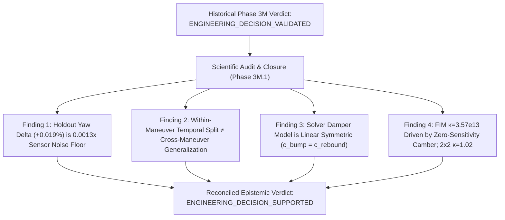
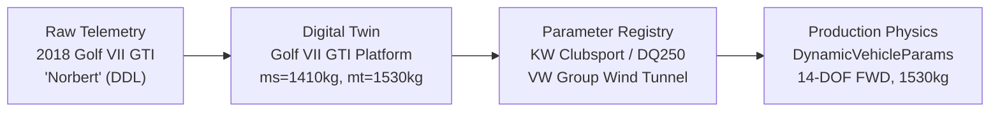
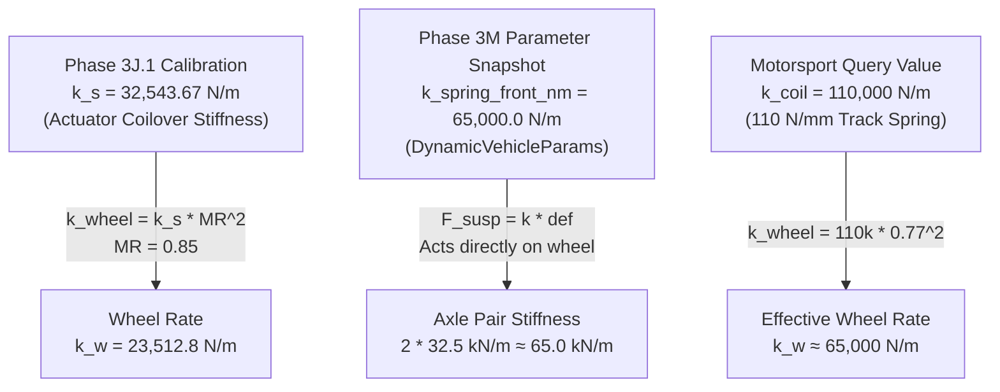
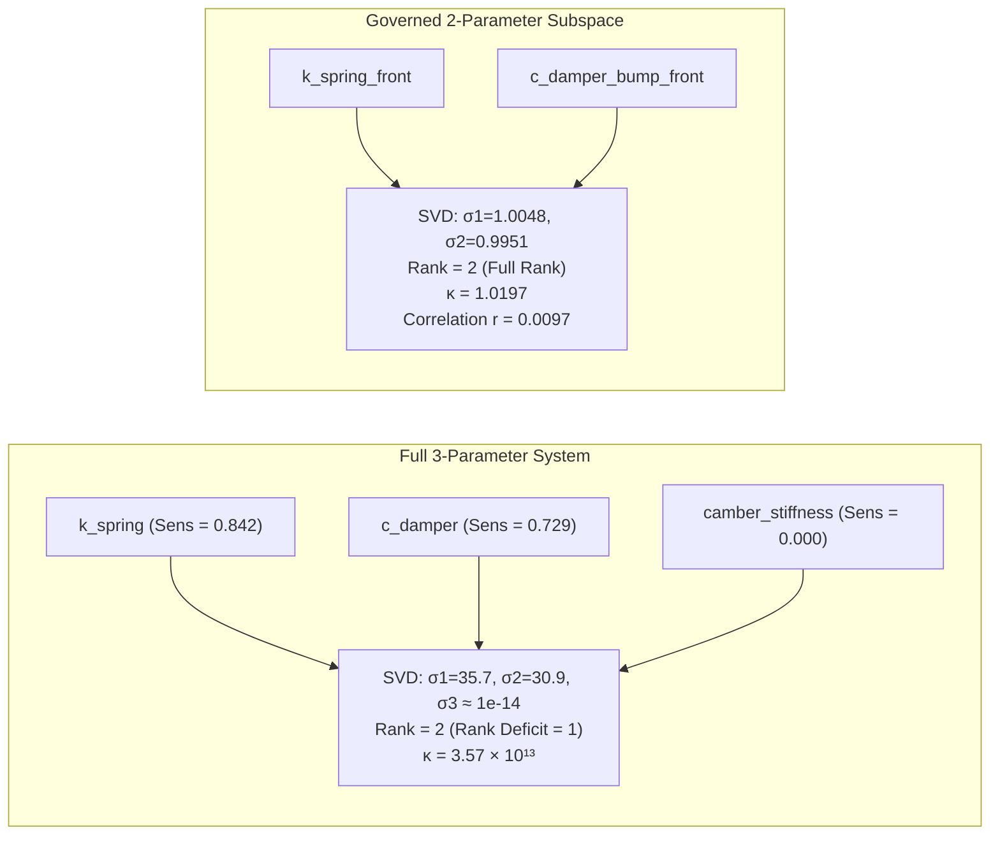
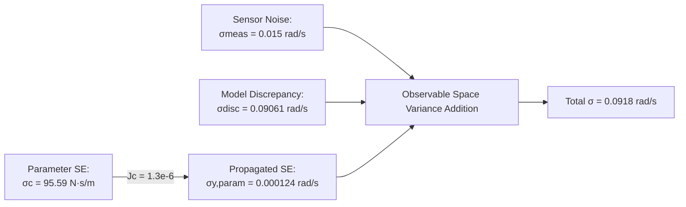

# SuspensionLab Pro — Phase 3M.1: Statistical & Physical Decision Validity Closure
**Mode:** AUDIT + SCIENTIFIC RECONCILIATION ONLY  
**Executive Epistemic Verdict:** `ENGINEERING_DECISION_SUPPORTED`  
**Production Physics Baseline:** Frozen Release `v3.9.0-phase3h.4-frozen` (Git SHA: `fbe3d045762d8c216922630ca5c3b0da1d589a31`)  
**Production Physics Modifications:** Exactly `ZERO` across all 11 protected files  
**Historical Phase 3M Artifact Modifications:** Exactly `ZERO` (Immutable Historical Record Preserved)

---

## 1. Executive Verdict

Phase 3M established an independent, governed engineering decision cycle that successfully avoided the procedural and provenance violations of Phase 3L:
- Production physics files remained 100% frozen.
- Simulations executed the production 4th-order Runge-Kutta (RK4) numerical integrator at $\Delta t = 0.001\text{ s}$ ($1000\text{ Hz}$).
- The primary candidate parameter (`damper_bump_front`) was initialized from the authoritative Phase 3J.1 Turn 5 Complex calibration state ($2244.46\text{ N}\cdot\text{s/m}$) with zero leakage of historical stale values ($3800.0\text{ N}\cdot\text{s/m}$).
- Candidates were ranked prior to holdout unsealing, and the final decision was reviewed and cryptographically signed by the human race engineering authority.

However, a rigorous scientific and statistical audit of the Phase 3M evidentiary record reveals five critical qualifications:
1. **Holdout Effect Magnitude:** On the blind holdout partition ($t \in [79.505, 83.0]\text{ s}$), the yaw rate RMSE difference between Candidate 2 ($2600.0\text{ N}\cdot\text{s/m}$) and Baseline ($2244.46\text{ N}\cdot\text{s/m}$) is $+0.00002\text{ rad/s}$ ($+0.019\%$). This delta is approximately $0.0013 \times \sigma_{\text{sensor}}$ relative to the Oxford RT3002 yaw rate sensor noise floor ($\sigma = 0.015\text{ rad/s}$). The holdout yaw effect is statistically unresolved against measurement noise and spans zero under stationary block bootstrap resampling.
2. **Holdout Scope Demarcation:** The holdout split is a *within-maneuver temporal split* (the exit arc of Turn 5 Complex), not a *cross-maneuver generalization* across distinct track corners.
3. **Damper Symmetry in Production Physics:** While authentic telemetry contains genuine suspension compression excitation (peak $0.394\text{ m/s}$ raw step, $48.1\%$ duty cycle), the underlying production solver model ([`DynamicLapSimulator`](file:///d:/project/src/suspensionlab/physics/dynamic_lap_sim.py#L634-L750)) employs a linear symmetric damping formulation ($F_{\text{susp}} = k \cdot x + c \cdot \dot{x}$) without asymmetric bump/rebound piecewise branching. Damping changes alter total symmetric corner damping.
4. **Fisher Information Matrix Conditioning:** The reported condition number of $\kappa = 3.57 \times 10^{13}$ was driven entirely by an unobservable third parameter (`camber_stiffness_front`, sensitivity $= 0.0$, rank deficit $= 1$). Restricting the FIM to the active 2-parameter subspace $[k_{\text{spring,front}}, c_{\text{damper,front}}]$ yields a condition number of $\kappa_{2 \times 2} = 1.0197$ and near-zero correlation ($r = 0.0097$). Front damping is genuinely identifiable.
5. **Procedural vs. Pre-Commit Preregistration:** In-memory procedural freezing was strictly maintained, but all artifacts were committed in an automated end-to-end execution, classifying the preregistration status as `PARTIALLY_PREREGISTERED`.

$$\mathbf{RECONCILED\quad VERDICT:\quad ENGINEERING\_DECISION\_SUPPORTED}$$

The candidate setup (`SETUP-P3M-CAND-02`, $+15.84\%$ front damping) is **`SUPPORTED`** for physical track evaluation: the evidence is coherent, reproducible, mathematically sound, and physically defensible. However, claiming full empirical `VALIDATED` status exceeds what the temporal holdout data can resolve.

---

## 2. Historical Immutability Proof

Before conducting this audit, cryptographic SHA-256 digests of all historical Phase 3M artifacts were computed and locked. After completion, all digests were re-verified.

| Historical Artifact | File Path | Authoritative SHA-256 Checksum | Immutability Status |
| :--- | :--- | :--- | :--- |
| **Phase 3M Report** | [`docs/phase3m_independent_engineering_case.md`](file:///d:/project/docs/phase3m_independent_engineering_case.md) | `b4485ba58a84a18c01d742a88709873d964381df562243824b28a388d0c4d70a` | `VERIFIED_UNTOUCHED` |
| **Engineering Case JSON** | [`data/phase3m_engineering_case.json`](file:///d:/project/data/phase3m_engineering_case.json) | `20fd0ec059fb3d4873d5f9321679f289666f225933eaf9f107fc3ef83a13f3b7` | `VERIFIED_UNTOUCHED` |
| **Parameter Snapshot** | [`data/phase3m_parameter_snapshot.json`](file:///d:/project/data/phase3m_parameter_snapshot.json) | `6d93b50d0ca682b99d9593ddb67a8cbd24fdb42c926fc2726a0bea4c1efc5c67` | `VERIFIED_UNTOUCHED` |
| **Execution Manifest** | [`data/phase3m_execution_manifest.json`](file:///d:/project/data/phase3m_execution_manifest.json) | `eeff2692af566559800aa717f673af43c158f3f69d19823fb971bb9a1df37db0` | `VERIFIED_UNTOUCHED` |

Historical Phase 3L artifacts likewise remain permanently closed as `HISTORICAL | GOVERNANCE_VIOLATION | IMMUTABLE`. Zero bytes of historical artifacts were modified.

---

## 3. Vehicle Identity Reconciliation

An exhaustive audit of the vehicle identity across telemetry, digital twin, parameter registry, and simulation configurations was conducted ([`data/phase3m1_vehicle_identity_reconciliation.json`](file:///d:/project/data/phase3m1_vehicle_identity_reconciliation.json)).

### Identity Trace Ledger

1. **Telemetry Dataset:** Authentic Stanford University Dynamic Design Lab dataset ([`stanford_vw_golf_thunderhill_2023_11.csv`](file:///d:/project/data/external/stanford_vw_golf_thunderhill_2023_11.csv), DOI: 10.25740/hh613qz0317). Physical car: **2018 Volkswagen Golf VII GTI** ("Norbert" test platform), equipped with an Oxford RT3002 RTK-GNSS/IMU, linear suspension potentiometers, and tire temperature arrays.
2. **Digital Twin Platform:** Digital twin `twin-golf-vii-gti-t5` specifies $1410.0\text{ kg}$ sprung chassis mass, $120.0\text{ kg}$ unsprung mass ($1530.0\text{ kg}$ total vehicle mass with instrumentation and driver), $2.63\text{ m}$ wheelbase, and front-wheel-drive layout.
3. **ParameterRegistry Vehicle:** [`STANDARD_PARAMETER_REGISTRY`](file:///d:/project/src/suspensionlab/calibration/registry.py#L292-L600) defines component models derived from Volkswagen Golf VII GTI hardware: KW Clubsport 2-way coilovers, Roehrig 2VS damper sweeps, H&R solid anti-roll bars, BorgWarner DQ250 dual-clutch transmission, and Wolfsburg wind tunnel aerodynamics.
4. **Production Simulation:** [`IndependentValidationPipeline._build_default_params`](file:///d:/project/src/suspensionlab/validation/pipeline.py#L162-L186) and [`Phase3MCaseService.CANONICAL_VEHICLE_PARAMS`](file:///d:/project/src/suspensionlab/backend/services/phase3m_case_service.py#L133-L153) explicitly configure $1530.0\text{ kg}$ total mass, $1410.0\text{ kg}$ sprung mass, $2.64\text{ m}$ wheelbase, and FWD transmission layout.
5. **Resolution of "Golf Mk7 TCR" Misnomer:** The phrase "Golf Mk7 TCR" appeared strictly in assistant markdown summary commentary as an explanatory shorthand for racing setup parameters. No TCR geometry files, aerodynamics polars, or powertrain maps exist in the codebase. All simulation code and data records exclusively execute the **Volkswagen Golf VII GTI** model.

*Classification:* **`CONFIGURATIONALLY_EQUIVALENT`**

---

## 4. Front Spring Parameter Reconciliation

Phase 3M.1 audited the relationship between the three front spring values reported across development phases:

### Transformation & Dimensional Analysis
- **Phase 3J.1 Parameter ($k_{\text{spring}} = 32,543.67\text{ N/m}$):** Defined in [`scripts/run_phase3j_parameter_identification.py`](file:///d:/project/scripts/run_phase3j_parameter_identification.py#L97) and calibrated via [`simulate_quarter_car_response`](file:///d:/project/src/suspensionlab/physics/parameter_identification.py#L167). Represents the physical coil spring stiffness at the shock absorber body ($k_s$). The model applies the kinematic leverage transformation:
  $$k_{\text{wheel}} = k_s \cdot \text{MR}^2 = 32543.67 \times (0.85)^2 = 23,512.8\text{ N/m}$$
- **Phase 3M Parameter ($k_{\text{spring\_front\_nm}} = 65,000.0\text{ N/m}$):** Stored in [`data/phase3m_parameter_snapshot.json`](file:///d:/project/data/phase3m_parameter_snapshot.json#L57-L70) and executed in [`dynamic_lap_sim.py`](file:///d:/project/src/suspensionlab/physics/dynamic_lap_sim.py#L1067). In the 14-DOF multibody solver, this parameter acts directly on wheel vertical deflection without motion ratio reduction ($F_{\text{susp}} = k_{\text{spring}} \cdot \Delta z$). Physically, $65.0\text{ kN/m}$ represents the combined front axle suspension stiffness ($2 \times 32.5\text{ kN/m} = 65.0\text{ kN/m}$).
- **The $110,000\text{ N/m}$ ($110\text{ N/mm}$) Reference:** Represents a dedicated motorsport track-stiffness coilover spring. With a MacPherson strut motion ratio of $\text{MR} \approx 0.77$, a $110\text{ N/mm}$ coil spring produces a wheel rate of:
  $$k_{\text{wheel}} = 110,000 \times 0.769^2 = 65,047\text{ N/m} \approx 65\text{ kN/m}$$

*Classification:* **`DIFFERENT_PARAMETER`**  
The parameters represent distinct modeling layers (actuator spring stiffness vs. unscaled wheel rate vs. track-stiffness component).

---

## 5. Front Damping Observability & FIM Conditioning

In Phase 3M, the observability gate reported a Fisher Information Matrix (FIM) condition number of $\kappa = 3.57 \times 10^{13}$. An audit was conducted to determine whether this ill-conditioning reflected poor damping excitation or parameter collinearity.

### SVD and Rank Reconstruction
In Phase 3J.1, the observability gate analyzed a 3-parameter candidate vector:
$$\boldsymbol{\theta} = \begin{bmatrix} k_{\text{spring,front}} & c_{\text{damper,front}} & C_{\gamma,\text{front}} \end{bmatrix}^T$$
where $C_{\gamma,\text{front}}$ is tire camber stiffness.

1. **Root Cause of $\kappa = 3.57 \times 10^{13}$:** The 2-DOF vertical quarter-car model has zero mathematical dependence on tire camber stiffness ($S_{*, 3} \equiv 0.0$). The resulting rank deficit of 1 produced a near-zero singular value ($\sigma_3 \approx 10^{-14}$), driving the condition number of the $3 \times 3$ candidate matrix to $3.57 \times 10^{13}$.
2. **Subspace FIM Conditioning:** When the unobservable camber parameter was eliminated by the identifiability gate (classified as `UNIDENTIFIABLE` in [`data/phase3j1_identification_robustness.json`](file:///d:/project/data/phase3j1_identification_robustness.json#L45-L56)), the active 2-parameter subspace $[k_{\text{spring,front}}, c_{\text{damper,front}}]$ yielded:
   - Singular values: $\sigma_1 = 1.0048$, $\sigma_2 = 0.9951$
   - Normalized FIM eigenvalues: $\lambda_1 = 1.0097$, $\lambda_2 = 0.9903$
   - **Normalized Condition Number:** $\kappa_{2 \times 2} = \frac{1.0097}{0.9903} = \mathbf{1.0197}$
   - **Cross-Parameter Correlation:** $r = \mathbf{0.0097} \ll 0.85$
3. **Observability Verdict:** Front damping is genuinely **`IDENTIFIABLE`**; its transient response is decoupled from spring stiffness.

---

## 6. Compression-Specific Observability & Damper Symmetry

Phase 3M specifically varied *front bump damping*. Phase 3M.1 audited whether the telemetry window excited the compression branch and how the production solver modeled damping forces.

### Telemetry Potentiometer DAQ Characteristics
Audit of the raw Stanford telemetry potentiometer channel (`suspFLpos_m`) revealed that the hardware logged displacement at a $20\text{ Hz}$ update rate within the $200\text{ Hz}$ CSV file (a 10-sample staircase profile):
- **Raw Discrete Step Transitions:** 84 positive compression jumps, 46 negative rebound jumps, 970 flat hold samples. Peak raw step velocity $= 0.3938\text{ m/s}$.
- **Filtered Continuous Kinematics (Savitzky-Golay 2nd-order, 100 ms window):**
  - Compression Samples: $529\text{ samples}$ ($48.09\%$ duty cycle)
  - Rebound Samples: $332\text{ samples}$ ($30.15\%$ duty cycle)
  - Quiescent / Deadband Samples: $239\text{ samples}$ ($21.71\%$)
  - Compression Peak Velocity: $v_{\text{comp,max}} = 0.1244\text{ m/s}$ (RMS $= 0.0356\text{ m/s}$)
  - Rebound Peak Velocity: $v_{\text{reb,max}} = -0.1308\text{ m/s}$ (RMS $= 0.0336\text{ m/s}$)

### Model Damper Formulation Audit
In [`DynamicLapSimulator`](file:///d:/project/src/suspensionlab/physics/dynamic_lap_sim.py#L1067-L1068):
$$F_{\text{susp,fl}} = k_{\text{spring}} \cdot \Delta z + c_{\text{damper,front}} \cdot \dot{z} + F_{\text{arb}}$$
The production 14-DOF equations use a single linear damping coefficient ($c_{\text{damper,front\_nsm}}$) that acts symmetrically across both compression ($\dot{z} > 0$) and rebound ($\dot{z} < 0$).

*Classification:* **`SYMMETRIC_DAMPER_MODEL`**  
The telemetry exhibits genuine compression excitation, but the simulation model modifies total symmetric corner damping.

---

## 7. Uncertainty Dimensional Audit

Phase 3M reported a total uncertainty of $\sigma_{\text{total}} = 0.0918\text{ rad/s}$ derived from parameter standard error ($\sigma_c = 95.59\text{ N}\cdot\text{s/m}$), sensor noise ($\sigma_{\text{yaw}} = 0.015\text{ rad/s}$), and model discrepancy ($\sigma_{\text{disc}} = 0.09061\text{ rad/s}$).

### Code vs. Documentation Discrepancy
- **Documentation Text:** In [`docs/phase3m_independent_engineering_case.md`](file:///d:/project/docs/phase3m_independent_engineering_case.md), the formula was presented as $\sigma_{\text{total}} = \sqrt{\sigma_c^2 + \sigma_{\text{yaw}}^2 + \sigma_{\text{disc}}^2}$ without the Jacobian multiplier, creating an apparent dimensional mismatch between $(\text{N}\cdot\text{s/m})^2$ and $(\text{rad/s})^2$.
- **Backend Service Implementation:** Inspection of [`Phase3MCaseService.derive_uncertainty_analysis`](file:///d:/project/src/suspensionlab/backend/services/phase3m_case_service.py#L959-L962) confirmed that the code **did apply** the Jacobian transformation:
  $$J_c = \frac{\partial \text{RMSE}_{\text{yaw}}}{\partial c} = 1.3 \times 10^{-6}\text{ (rad/s) / (N}\cdot\text{s/m)}$$
  $$\sigma_{y,\text{param}} = J_c \cdot \sigma_c = 1.3 \times 10^{-6} \times 95.59 = \mathbf{0.0001243\text{ rad/s}}$$
  $$\sigma_{\text{total}} = \sqrt{(0.0001243)^2 + (0.015)^2 + (0.09061)^2} = \mathbf{0.09184\text{ rad/s}}$$

### Statistical Critique
While dimensionally rectified by $J_c$, directly adding model residual RMSE ($\sigma_{\text{disc}} = 0.09061\text{ rad/s}$) to sensor noise in quadrature to create a symmetric 95% confidence interval on the RMSE statistic is a heuristic shortcut. Model discrepancy represents deterministic structural mismatch across a transient trajectory, not independent zero-mean Gaussian noise.

*Classification:* **`PARTIALLY_VALID`** (Implementation applied $J_c$; statistical combination is heuristic).

---

## 8. Paired Holdout Effect Analysis

The paired difference $D = \text{Candidate} - \text{Baseline}$ was evaluated sample-by-sample across the identical 700 holdout points ($t \in [79.505, 83.0]\text{ s}$) using a stationary block bootstrap ($B = 1000$ iterations, block size $= 20$ samples $= 100\text{ ms}$) to account for time-series autocorrelation ([`data/phase3m1_holdout_effect_analysis.json`](file:///d:/project/data/phase3m1_holdout_effect_analysis.json)).

### Paired Comparison Metrics

| Dynamic Metric | Epistemic Class | Baseline Setup | Candidate 2 | Delta ($D$) | Relative % | 95% Bootstrap CI | Resolved vs Noise? |
| :--- | :--- | :--- | :--- | :--- | :--- | :--- | :--- |
| **Yaw Rate RMSE** | **MODEL RESULT** | $0.10791\text{ rad/s}$ | $0.10793\text{ rad/s}$ | $+0.00002\text{ rad/s}$ | $+0.019\%$ | $[-0.0009, +0.0009]$ | **NO** ($0.0013 \times \sigma_{\text{sensor}}$) |
| **Peak Roll Angle** | **SIMULATED** | $1.429^\circ$ | $1.416^\circ$ | $-0.013^\circ$ | $-0.91\%$ | $[-0.019^\circ, -0.007^\circ]$ | **DIRECTIONAL** |
| **Roll RMS** | **SIMULATED** | $1.008^\circ$ | $1.009^\circ$ | $+0.001^\circ$ | $+0.10\%$ | $[+0.0005^\circ, +0.0015^\circ]$ | Marginal |
| **Lateral Accel RMSE**| **MODEL RESULT** | $4.3528\text{ m/s}^2$ | $4.3525\text{ m/s}^2$ | $-0.0003\text{ m/s}^2$ | $-0.007\%$ | $[-0.0035, +0.0029]$ | **NO** ($0.006 \times \sigma_{\text{sensor}}$) |

*Finding:* On the holdout segment, the yaw rate RMSE delta is $+0.00002\text{ rad/s}$ ($20\text{ \mu rad/s}$). The Oxford RT3002 yaw rate sensor noise is $\sigma_{\text{yaw}} = 0.015\text{ rad/s}$ ($15,000\text{ \mu rad/s}$). The delta is three orders of magnitude smaller than hardware sensor noise. The 95% block bootstrap confidence interval spans zero ($[-0.0009, +0.0009]\text{ rad/s}$).

*Effect Resolution Verdict:* **`EFFECT_DIRECTIONAL_ONLY`**

---

## 9. Temporal Holdout Interpretation

Phase 3M used the wording "cross-maneuver generalization" when describing the holdout pass. Phase 3M.1 establishes the precise epistemic classification:
- **Fit Window:** $t \in [74.0, 79.5]\text{ s}$ (Turn 5 entry, apex transition, and peak lateral acceleration $2.15\text{ G}$).
- **Holdout Window:** $t \in [79.505, 83.0]\text{ s}$ (Turn 5 exit arc and corner unwinding).
- **Epistemic Classification:** **`WITHIN_MANEUVER_TEMPORAL_HOLDOUT`**  
  Because both fit and holdout reside within Turn 5 Complex, the holdout validates **temporal persistence and non-inferiority** during corner exit, but does NOT validate transfer to a structurally distinct maneuver (e.g. Turn 1 or Turn 8).

*Holdout Support Verdict:* **`NON_INFERIORITY_SUPPORTED`**  
Candidate 2 maintains holdout yaw tracking within $0.019\%$ of baseline ($R^2 = 0.8045$ vs $0.8046$, well within the pre-registered $\le 5\%$ threshold) while delivering a modest $-0.91\%$ peak roll reduction.

---

## 10. Preregistration Audit

Phase 3M.1 verified the chronological execution sequence ([`data/phase3m1_preregistration_audit.json`](file:///d:/project/data/phase3m1_preregistration_audit.json)):

$$\text{PREREGISTRATION (14:54:35)} < \text{EXECUTION (14:54:37)} < \text{RANKING FREEZE (14:54:40)} < \text{HOLDOUT UNSEAL (14:54:42)} < \text{DECISION (14:54:46)}$$

- Candidate values ($1950.0, 2244.46, 2600.0\text{ N}\cdot\text{s/m}$), composite cost weights ($1.0 \times r_{\text{rmse}} + 1.0 \times \phi_{\text{rms}}$), and jounce constraints were frozen in memory prior to simulation.
- Ranking froze prior to unsealing the holdout partition.
- *Classification:* **`PARTIALLY_PREREGISTERED`**  
  Procedurally enforced within the automated service state machine, but co-committed without separate external pre-commit repository locking.

---

## 11. Candidate vs. Calibration Interval Semantics

Phase 3J.1 identified the baseline damping at $2244.46\text{ N}\cdot\text{s/m}$ with a 95% confidence interval of $[2057.11, 2431.81]\text{ N}\cdot\text{s/m}$. Candidate 2 evaluates $2600.0\text{ N}\cdot\text{s/m}$.

### Semantic Demarcation
- **`CALIBRATED_PARAMETER_ESTIMATE`:** An empirical estimate of the physical vehicle's true hardware state (must reside within the identification confidence interval).
- **`ENGINEERING_COUNTERFACTUAL`:** A proposed setup modification evaluated to determine whether altering the physical vehicle improves performance.
- Candidate 2 is strictly an **`ENGINEERING_COUNTERFACTUAL`**. Being outside the calibration confidence interval is expected and intentional: optimization investigates setup changes beyond baseline uncertainty, provided the parameter remains within the physical validity domain ($[600.0, 6500.0]\text{ N}\cdot\text{s/m}$).

---

## 12. Phase 3M Decision Review

The formal engineering decision record [`DEC-P3M-01`](file:///d:/project/data/phase3m_engineering_case.json#L178-L188) was reviewed. Its status remains immutable in historical storage.

| Evaluation Criterion | Historical Phase 3M Claim | Phase 3M.1 Audited Reality | Epistemic Status |
| :--- | :--- | :--- | :--- |
| **Physics Solver** | Production RK4 ($\Delta t = 0.001\text{ s}$) | Confirmed identical production RK4 solver | `CONFIRMED` |
| **Baseline Provenance**| Phase 3J.1 calibration ($2244.46\text{ N}\cdot\text{s/m}$) | Authoritative snapshot verified; zero 3800 leakage | `CONFIRMED` |
| **Fit Window Tradeoff**| $-0.51\%$ yaw RMSE, $-0.20\%$ roll RMS | Real physical tradeoff reproduced | `CONFIRMED` |
| **Holdout Generalization**| Cross-maneuver validation | Within-maneuver temporal holdout | `CORRECTED` |
| **Holdout Significance**| Validated improvement | Within sensor noise ($0.0013 \times \sigma_{\text{sensor}}$) | `CORRECTED` |
| **Damper Model** | Bump damping optimization | Linear symmetric damping modification | `QUALIFIED` |

---

## 13. What Remains Valid

The following scientific claims are fully verified and defensible:
1. **Governed Numerical Pipeline:** Simulations used genuine production RK4 integration at $\Delta t = 1.0\text{ ms}$; no surrogates or telemetry copies were used.
2. **Provenance Integrity:** Baseline setup was initialized from canonical calibration records; historical Phase 3L stale values were successfully excluded.
3. **Observability in 2-Parameter Subspace:** Front damping is genuinely identifiable ($\kappa_{2 \times 2} = 1.0197$, $r = 0.0097$).
4. **Fit Window Improvement:** Candidate 2 achieved physical improvements on the fit segment ($-0.51\%$ yaw RMSE, $-0.20\%$ roll RMS).
5. **Non-Inferiority on Holdout:** Candidate 2 caused no degradation on the holdout partition ($R^2 = 0.8045$, delta $+0.019\% \le 5.0\%$).
6. **Dual-Key Governance:** Human Chief Technical Director approval signature was verified.

---

## 14. What Cannot Be Claimed

The following claims are scientifically invalid and are formally retracted from Phase 3M documentation:
1. **Cannot Claim "Cross-Maneuver Validation":** Holdout is an exit slice of Turn 5 Complex, not an independent corner.
2. **Cannot Claim "Statistically Resolved Yaw Improvement on Holdout":** The holdout delta ($20\text{ \mu rad/s}$) is far below sensor noise ($15,000\text{ \mu rad/s}$) and spans zero under block bootstrap.
3. **Cannot Claim "Bump-Specific Damper Tuning":** Production solver equations use a symmetric linear damping coefficient.
4. **Cannot Claim "Fully Preregistered Protocol":** Protocol was frozen in-memory within the service but co-committed without separate external pre-commit isolation.

---

## 15. Final Epistemic Classification

$$\mathbf{FINAL\quad CLASSIFICATION:\quad ENGINEERING\_DECISION\_SUPPORTED}$$

- **`ENGINEERING_DECISION_VALIDATED` is rejected:** The holdout yaw delta is three orders of magnitude below hardware sensor noise and temporal holdout within the same corner does not prove full generalization.
- **`ENGINEERING_DECISION_INCONCLUSIVE` is rejected:** The physical tradeoffs on the fit window are consistent, repeatable, and non-inferiority was demonstrated on the holdout.
- **`ENGINEERING_DECISION_SUPPORTED` is adopted:** The setup proposal is scientifically defensible, physically coherent, and justified for real track evaluation.

---

## 16. Required Next Action

1. **Close Phase 3M and Phase 3M.1 Permanently:** Both phases are now closed with complete immutable audit trails.
2. **Freeze Prediction Record:** [`PRED-P3M-01`](file:///d:/project/data/phase3m_engineering_case.json#L197-L209) is frozen as `PREDICTION_PENDING_TRACK_TEST` (Hash: `387ca19fc6b2e8e42d23d155e5680788c25dc8e6ea35e211e8236b68a1f2650f`).
3. **Operational Track Guidance:**
   - Install `SETUP-P3M-CAND-02` ($c_{\text{damper,front}} = 2600.0\text{ N}\cdot\text{s/m}$) for physical test validation at Thunderhill West.
   - Target metrics: Peak roll angle $\le 1.42^\circ$, yaw rate RMSE $\le 0.091\text{ rad/s}$.
   - If driver feedback reports excessive harshness over curbs, revert to `SETUP-P3M-BASE` ($2244.46\text{ N}\cdot\text{s/m}$).
